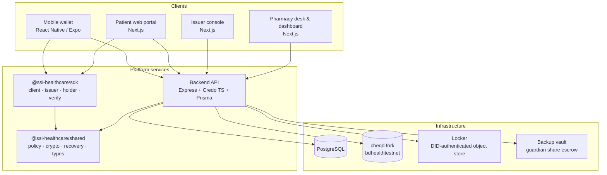

# SSI Healthcare

**Self-sovereign identity for healthcare records.** Patients hold their own verifiable credentials, institutions issue and verify them, and every access decision is explicit, consent-bound, and auditable.


---

## Overview

SSI Healthcare is a full-stack decentralized identity platform built for the healthcare sector. It replaces the "call the registry and ask" model of credential verification with cryptographic proof that travels with the patient:

- **Patients** carry a mobile wallet holding signed health credentials — prescriptions, immunisations, discharge summaries, professional licences and decide what to disclose, to whom, and for how long.
- **Issuers** (hospitals, councils, clinics, labs) publish credentials over **OpenID for Verifiable Credential Issuance (OID4VCI)** and anchor their DIDs on a sovereign **cheqd** ledger fork.
- **Verifiers** (pharmacies, hospitals, insurers) request presentations over **OpenID for Verifiable Credential Presentation (OID4VP)** and verify signatures locally, without asking the issuer's servers.
- **Selective disclosure** is a first-class citizen: SD-JWT VC frames are built from the same policy module on the server, in the SDK, and in the wallet, so a choice made by a human is the only thing that decides what a verifier sees.

The system covers the full credential lifecycle: enrolment, issuance, presentation, consent, emergency access, re-issuance, revocation via status lists, and cryptographic custody monitoring of every institutional DID.

---

## Demo videos

Nine walkthroughs of the system in action. Click a preview to open the video on Google Drive.

<table>
  <tr>
    <td align="center">
      <a href="https://drive.google.com/file/d/1BZnBJw8z66fiSaNOPbyt6vdDM59_90o_/view">
        
      </a>
      <br>
      <sub><b>Demo 1</b></sub>
    </td>
    <td align="center">
      <a href="https://drive.google.com/file/d/1DHCsZAVfBijO_cn_TBJ89aMhlfttIiqy/view">
        
      </a>
      <br>
      <sub><b>Demo 2</b></sub>
    </td>
    <td align="center">
      <a href="https://drive.google.com/file/d/1-SlgeYpOCPbulkPydWv7MbfWy6p-2W8e/view">
        
      </a>
      <br>
      <sub><b>Demo 3</b></sub>
    </td>
  </tr>
  <tr>
    <td align="center">
      <a href="https://drive.google.com/file/d/1cKGsk1qUpv_5AaUQyHzZO3k_Wbn_2ow5/view">
        
      </a>
      <br>
      <sub><b>Demo 4</b></sub>
    </td>
    <td align="center">
      <a href="https://drive.google.com/file/d/1t3a_vjA2c0eGy-__wMLyOJekYGUVIuSz/view">
        
      </a>
      <br>
      <sub><b>Demo 5</b></sub>
    </td>
    <td align="center">
      <a href="https://drive.google.com/file/d/1oyyXNu42vESHyHFSLbAqpDPtxWTpB_ZD/view">
        
      </a>
      <br>
      <sub><b>Demo 6</b></sub>
    </td>
  </tr>
  <tr>
    <td align="center">
      <a href="https://drive.google.com/file/d/1EIk3NqCm8D2HzBZvG7bKtQI71LzxvAiV/view">
        
      </a>
      <br>
      <sub><b>Demo 7</b></sub>
    </td>
    <td align="center">
      <a href="https://drive.google.com/file/d/1--g3-Jr8qYPyBJa4pIXUsV2I7-Qh2gcF/view">
        
      </a>
      <br>
      <sub><b>Demo 8</b></sub>
    </td>
    <td align="center">
      <a href="https://drive.google.com/file/d/1XQnL73CJsCPrdi-4kKjfyExAV8oHSLLW/view">
        
      </a>
      <br>
      <sub><b>Demo 9</b></sub>
    </td>
  </tr>
</table>

---

## Architecture



---

## Modules

| Module | Path | Responsibility |
| --- | --- | --- |
| Backend API | `backend/` | Express server, Credo agent, OID4VCI/OID4VP endpoints, consent, emergency access, custody, re-issuance, webhooks, audits. Prisma + PostgreSQL. |
| Shared library | `shared/` | Cross-cutting types, disclosure policy, accreditation trust roots, consent receipts, recovery primitives (SLIP-39, key envelopes), crypto ciphers, worklet crypto subset. |
| SSI SDK | `sdk/` | `SSIClient`, issuer agent + Express router, holder presentation flows, cheqd ledger helpers, local SD-JWT verification, React bindings, webhook verification. |
| Mobile wallet | `mobile/` | Expo/React Native patient wallet: credentials, consent, emergency access, selective disclosure, QR flows, offline SQLite store with sync outbox, biometrics, guardian recovery. |
| Web portal | `web/` | Next.js patient and institutional portal: wallet, dashboards, role portals (admin, issuer, pharmacy, hospital, insurer, verifier), Playwright e2e suite. |
| Issuer console | `issuer-console/` | Authority-facing Next.js console: onboarding, roster, issuance queue, single-use keys, document crypto, permission checks. |
| Pharmacy demo | `pharmacy-demo/` | Counter display and seller dashboard: pairing, prescription rules, dispensing, token settlement, admin tooling. |
| Locker | `locker/` | DID-authenticated, policy-scoped encrypted object store (S3-compatible) with capability tokens and a reaper for abandoned uploads. |
| Backup vault | `backup-vault/` | Escrow for encrypted guardian shares; never sees plaintext shares or the KEK that protects them. |

---

## Repository layout

```
.
├── backend/          # Express API, Credo agent, Prisma schema, tests, tools
│   ├── prisma/       # Data model
│   ├── src/          # routes · services · middleware · db · custody · reissuance
│   ├── tests/        # fast · live · scenario
│   └── tools/        # Operational and proof scripts
├── shared/           # Disclosure, accreditation, recovery, crypto, worklet subset
├── sdk/              # Client, issuer, holder, ledger, verify, react, vendored sd-jwt
├── mobile/           # Expo wallet: screens, stores, services, db, sync
├── web/              # Next.js portal + Playwright e2e
├── issuer-console/   # Authority console
├── pharmacy-demo/    # Pharmacy desk display, dashboard, dispensing
├── locker/           # Encrypted object store
└── backup-vault/     # Guardian share vault
```

---

## Core flows

### Issuance: OID4VCI

1. An issuer creates a credential offer for a patient; the offer binds the intended holder and the credential subject.
2. The wallet redeems the offer at `/oid4vci/token` and requests the credential.
3. The backend signs the credential (SD-JWT VC and/or W3C VC) with the issuer's ledger-anchored key.
4. Credential status is tracked in a status list, and the offer is consumed exactly once.

### Presentation: OID4VP

1. A verifier publishes a request with a presentation definition and a fresh nonce.
2. The wallet resolves the requested claims and shows a human a disclosure choice per field.
3. The holder signs the presentation, bound to the verifier's audience and the nonce.
4. `sdk/verify/presentation.ts` checks issuer signature, holder signature, disclosure digests, nonce, audience, and `cnf` holder binding **locally**, against key material the relying party resolved itself.

### Consent

Consent is a first-class record, not a checkbox: purpose-scoped grants, access logs, cryptographic receipts, and webhook events (`consent.granted`, `consent.revoked`, `consent.expired`) so downstream systems can react to revocation.

### Emergency access

Emergency contacts, access levels, and activation methods are modelled explicitly. Break-glass access produces an emergency access record and is rate-limited separately, and every grant is provable with the `proveEmergencyAccess` tooling.

### Guardian recovery

A patient's recovery controller key is split with **SLIP-39** to guardians and never enters the backend's key store under the production custody policy (`device-held-guardian-split`). Remaining shares can be escrowed in the backup vault, encrypted with an AEAD key before they leave the enrolling process. Production refuses to boot in the legacy custodial mode.

### Custody monitoring

The backend watches institutional DIDs on-chain: it records observed transactions, decodes DID writes, maintains a signing audit hash chain, reconciles expectations against the ledger, and raises severity-classified custody alarms on divergence.

---

## Trust and data model

The Prisma schema (`backend/prisma/schema.prisma`) models the whole lifecycle, including:

| Area | Models |
| --- | --- |
| Identity | `User`, `DIDDocument`, `Passkey`, `Session`, `AuthChallenge`, `KeystoreEnvelope` |
| Credentials | `Credential`, `CredentialSchema`, `CredentialStatusList`, `CredentialOffer`, `ReissuanceAuthorisation` |
| Presentations & consent | `Presentation`, `PresentationCredential`, `Consent`, `ConsentAccessLog` |
| Emergency | `EmergencyContact`, `EmergencyAccessRecord` |
| Institutions | `Institution`, `InstitutionMember`, `InstitutionEnrolment` |
| Custody | `SigningAuditEntry`, `WatchedInstitutionalDid`, `ChainWatchCursor`, `ObservedDidTx`, `CustodyAlarm` |
| Governance & ops | `AuditLog`, `Webhook`, `WebhookDelivery`, `NotificationPreference`, `UXEvent` |
| Healthcare | `InsuranceClaim`, `HospitalConnection` |

DIDs use `did:key` for local development and `did:cheqd` for everything anchored on-ledger. The ledger network is `bdhealthtestnet` (with `bdhealth` reserved for production) — a sovereign fork, not cheqd's public testnet, so identifiers resolve against infrastructure this system controls.

---

## Security posture

- **Boundary hardening** — Helmet, CORS, body limits, purpose-specific rate limiters (auth, credentials, emergency, API), injection detection, request validation, sensitive-data filtering, and integrity checks run on every request.
- **Fail-fast configuration** — configuration is validated with Zod at boot. Production refuses to start with template secrets, with a custodial recovery mode, or with partially configured vault settings.
- **Keystore discipline** — two independent peppers pseudonymise handles and owners; the process refuses to start if they are equal.
- **Auditability** — actor context (source IP, device, request id) is attached at the edge; signing events form a hash chain; custody alarms carry severity and attribution.
- **Least disclosure** — the same disclosure policy module drives server, SDK, and wallet behavior, so a second divergent implementation cannot silently reveal the wrong field.
- **No committed credentials** — secrets are environment-scoped, and placeholder detection runs at startup so a copied template value cannot protect a production system.

---

## Configuration

The backend validates its environment at startup (`backend/src/config/index.ts`). Core variables:

| Variable | Required | Purpose |
| --- | --- | --- |
| `DATABASE_URL` | yes | PostgreSQL connection string |
| `JWT_SECRET` | yes | Signs OID4VCI access tokens (min 32 chars) |
| `WEB3AUTH_CLIENT_ID` | yes | Web3Auth MPC client id |
| `AGENT_WALLET_KEY` | yes | Unlocks the Credo agent wallet |
| `CHEQD_NETWORK` | no | `bdhealthtestnet` (default) or `bdhealth` |
| `CHEQD_RPC_URL` | no | Ledger RPC endpoint (default `http://localhost:26657`) |
| `COSMOS_PAYER_SEED` | no | Mnemonic or hex key that pays for DID writes; empty means read-only |
| `VERIFIER_DID` | no | Audience DID this backend expects in professional presentations |
| `INSTITUTIONAL_DID` | no | Co-controller of every patient enrolled here |
| `PATIENT_RECOVERY_CUSTODY` | no | `device-held-guardian-split` (production) or legacy `backend-held-phase-a` |
| `BACKUP_VAULT_URL` / `_SHARED_SECRET` / `_KEK` | together | Guardian share escrow (all three or none) |
| `KEYSTORE_HANDLE_PEPPER` / `KEYSTORE_OWNER_PEPPER` | no | Distinct HMAC peppers for keystore lookup |
| `SMTP_*` | no | Transactional email; disabled when unset |
| `CORS_ORIGIN`, `PORT`, `LOG_LEVEL`, `BODY_LIMIT` | no | Server tuning |

Service topology in a local deployment:

| Service | Default port |
| --- | --- |
| Backend API | `3001` |
| Web portal | `3000` |
| Locker | `4540` |
| Backup vault | `4530` |
| cheqd RPC | `26657` |
| PostgreSQL | `5432` |

> **Repository scope.** This repository contains application source. Workspace manifests, lockfiles, and environment templates are maintained alongside the code in the development environment and are not part of this snapshot.

---

## Testing strategy

| Layer | Location | What it proves |
| --- | --- | --- |
| Fast unit tests | `backend/tests/fast/` | Crypto envelopes, disclosure integrity, custody classification, credential binding, enrolment, settlement |
| Service tests | `backend/tests/` | Consent, credential, emergency, and security behavior |
| Live stack tests | `backend/tests/live/` | Real holder binding, revocation, professional authority, custody watch, re-issuance against a running stack |
| Scenario tests | `backend/tests/scenario/` | End-to-end prescription journey |
| SDK tests | `sdk/tests/` | Refresh deadlock safety, dependency direction guards, presentation verification, vendored SD-JWT integrity |
| Web e2e | `web/e2e/` | Accessibility, auth, wallet, consents, scanning, developer docs, visual performance |
| Mobile probes | `mobile/tools/`, `mobile/tests/` | Guardian runtime, passphrase envelopes, medicine balances |
| Worklet subset | `shared/tools/` | The reduced crypto build matches its full-fat counterparts |

---

<p align="center"><em>Patients own the credential. Institutions prove their authority. Every disclosure is a choice.</em></p>
